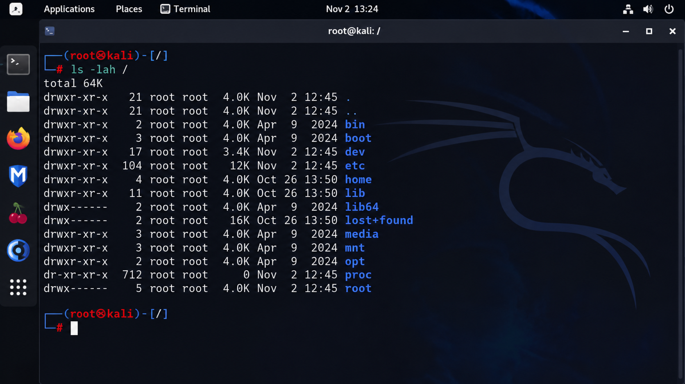
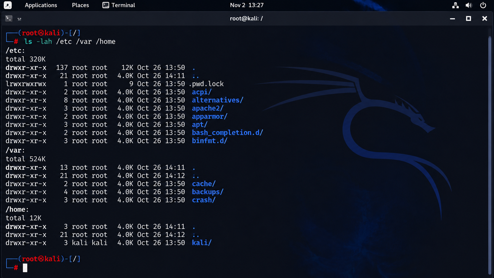
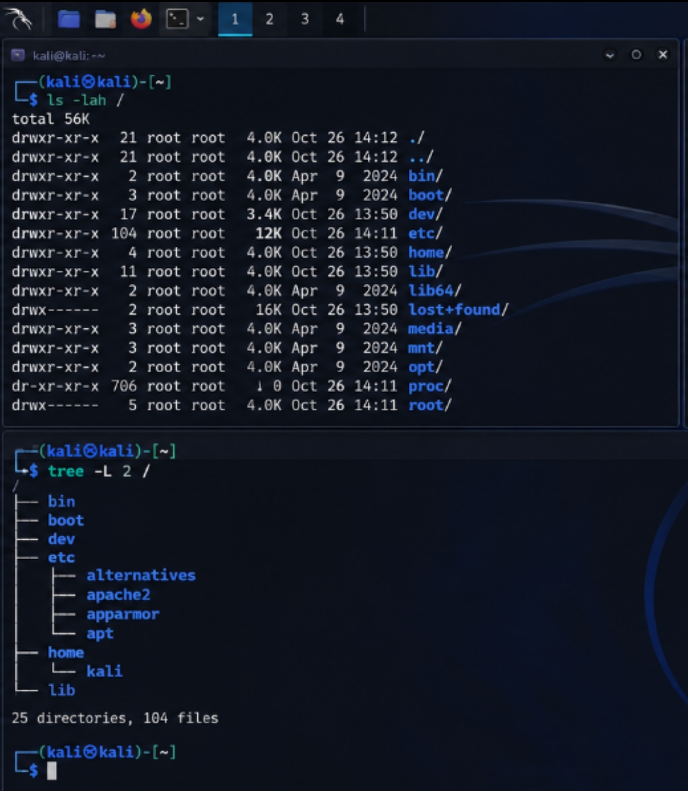

# Linux Filesystem Hierarchy

## Overview

The Linux filesystem hierarchy is the way files and directories are organised in a Linux operating system.

Unlike having separate directory structures for different drives like windows for example, Linux uses a single hierarchical structure that starts from the root directory (/).

Directories contain files and other directories, making in Linux 
Makes it easier more organized and easier to locate.

## The Root Directory (/)

The root directory (/) is the starting point of the entire Linux filesystem hierarchy.
Every other directory branches out from it, including /home, /etc, /var and /usr.

I've also come to understand that / is different from /root.
The former is the starting point of the entire Linux file system while the /root directory is the home of the root user 

In order to understand how linux file system is configured, I use basic commands to navigate and explore though different file path throughout the Linux file system 

## Important Directories

| Directory | Purpose |
|---|---|
| / | Root of the entire filesystem hierarchy. |
| /home | Contains regular users' home directories. |
| /root | Home directory of the root user. |
| /etc | Contains system-wide configuration files. |
| /var | Stores variable data such as logs and caches. |
| /tmp | Stores temporary files. |
| /usr | Contains user applications, utilities and shared resources. |
| /dev | Contains device files. |
| /proc | Provides information about processes and the kernel. |
| /boot | Contains files needed to boot the system. |

## Practical Exploration

Commands used:

- ls -lah / - To list the contents of the root directory
- pwd - To display your present working directory
- cd - To navigate between directories
- find - To find files with specific filters  

### Observations

Throughout my exploration of the Linux filesystem, I came to understand that directories have different purposes and are all organized under the root directory /.

## Screenshots

## Conclusion

Understanding the Linux filesystem hierarchy makes it easier to navigate and manage a Linux system. Knowing where important files and directories are located is also useful when troubleshooting system issues and managing your Linux OS.
